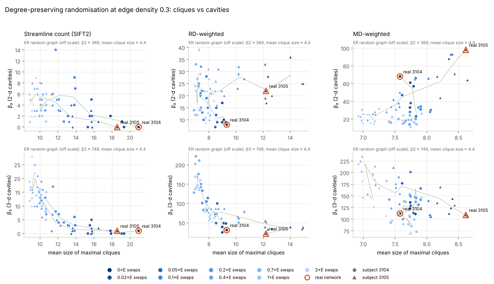
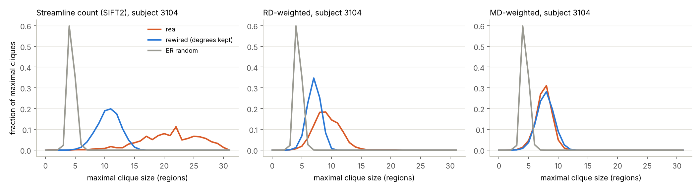

# What averaging hides in structural connectomes of Parkinson's disease

Shared code for Marcial Sanchis Agudo and Ilaria Carannante (KTH).

**Question.** Structural connectomes store one number per pair of regions: a
streamline count, or FA/MD/AD/RD averaged along and across all streamlines.
On PPMI, these mean-based connectomes do not separate PD from healthy controls
(Sinzinger et al., *Front. Hum. Neurosci.* 20:1769103, 2026). We test whether the
PD signal sits in what the averaging removes: the spread of tensor values along
and across streamlines, the gap between "invariant of the mean tensor" and
"mean of the invariant", and orientation dispersion.

The diffusion tensor is a covariance of water displacement and splits into an
isotropic part (MD) and a deviatoric part (anisotropy). Averaging tensors that
point in different directions cancels part of the deviatoric part, as filtering
does in turbulence. That cancelled part is what we measure.

**No subject data is stored here** (PPMI data use agreement). Data stay on
KTH OneDrive / local disks; scripts take a `--root` path.

## Layout

```
src/pdconn/io.py               load tck2connectome CSVs (unfiltered and SIFT2)
src/pdconn/graphs.py           thresholding, flag-complex Betti numbers, rewiring
src/pdconn/tensor_features.py  edge features beyond the mean (needs per-sample tensors)
scripts/check_redundancy.py    how many weightings are independent
scripts/tda_randomisation.py   cliques vs cavities under degree-preserving rewiring
scripts/make_figures.py        figures for the TDA check
tests/                         unit tests (pytest), synthetic inputs only
results/figures/               figures from the first two subjects
```

Expected data layout under `--root`:
`<subject>/connectivity{,_sift}/connectome{,_fa,_md,_ad,_rd}.csv`
(space-separated, upper triangle, as written by MRtrix `tck2connectome`).

## Setup

```
pip install -r requirements.txt
pytest -q
python scripts/check_redundancy.py --root DATA --subjects 3104 3105
python scripts/tda_randomisation.py --root DATA --subjects 3104 3105
python scripts/make_figures.py --root DATA
```

## First observations (subjects 3104 and 3105 only, groups unknown)

These are statements about the data structure, not about PD.

1. **MD is redundant.** On every edge, MD = (AD + 2 RD)/3 to median relative
   error 3e-4 (99th percentile 0.7-1.3 %). The five weightings carry at most
   four independent families (count + three tensor quantities).
2. **Averaging hides something measurable.** Streamline-averaged FA exceeds the
   FA computed from averaged AD and RD (axially symmetric formula) by
   +0.028 to +0.031 on average (sd ~0.018). This mixes along-tract heterogeneity
   with l2 != l3 and needs per-sample tensors to separate.
3. **Filtering barely reorders edges.** log streamline counts, unfiltered vs
   SIFT2, correlate at r = 0.990 within a subject.
4. **TDA: cliques and cavities move together under randomisation.** At edge
   density 0.3 (highest weights kept), degree-preserving rewiring shrinks
   maximal cliques and raises b3. Spearman(mean maximal clique size, b3) along
   the rewiring series: SC -0.87 / -0.74, RD -0.82 / -0.73 (3104 / 3105).
   b2 does not follow consistently, and MD behaves differently: its real and
   rewired clique-size distributions nearly coincide, so its clique structure
   is explained by node degrees. Open question for the TDA work: does the
   PD-HC difference go beyond a shift toward the degree-preserving null?
   Caveat: the poster's thresholding direction for RD/MD (`--keep high|low`)
   still needs to be matched.




## Next step: edge features beyond the mean

`tensor_features.edge_features(tensors, weights)` takes all tensor samples for
one edge (shape (N, 3, 3); weights e.g. SIFT2 x step length) and returns:

| feature | meaning |
|---|---|
| `mean_<m>` | what current connectomes store (m = fa, md, ad, rd) |
| `sd_<m>` | heterogeneity along/across streamlines |
| `defect_<m>` | mean of m minus m of the mean tensor (zero for MD by linearity) |
| `dispersion` | 1 - largest eigenvalue of the mean of v v^T over principal directions |
| `q_loss` | fraction of deviatoric magnitude cancelled by averaging |

Input needed per subject: per-streamline tensor samples (e.g. `tcksample` on
the six tensor components, or on FA/MD/AD/RD at minimum) with SIFT2 weights and
the parcellation, or tensor images + parcellation in subject space.

Plan: pilot (~20 labelled subjects) to fix definitions and the analysis
(pre-registered), then the full cohort with the same statistics and
classifiers as the Frontiers paper (TFNBS, BY correction, SVM/GNN), mean vs
beyond-mean features.

## Conventions

Every number in a manuscript comes from a script in this repository and is
reproducible from it. Negative results are reported.
